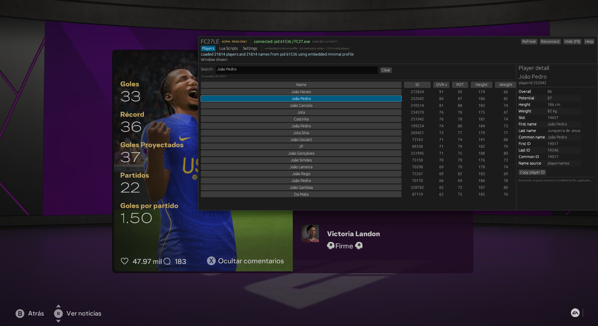

# FC27LE

**An experimental, open-source, read-only EA SPORTS FC 27 Live Editor alternative for Linux and Proton, built in Rust.**

[](https://github.com/Franku83/fc27le/actions/workflows/ci.yml)
[](LICENSE)
[](https://github.com/Franku83/fc27le/releases/tag/v0.1.0-alpha.2)

**[Download the Linux alpha](https://github.com/Franku83/fc27le/releases/tag/v0.1.0-alpha.2)** · [Report a bug](https://github.com/Franku83/fc27le/issues/new/choose) · [Contribute](CONTRIBUTING.md)

FC27LE connects to a running FC 27 process under Wine/Proton and browses real
player data through a native Linux GUI. It also runs a **tested read-only subset
of Live Editor Lua API v2** and can export Career Mode season statistics.



*Live captures from EA SPORTS FC 27 Career Mode and FC27LE, composed for presentation. The game and the app state are real.*

> **Experimental and read-only.** This alpha was validated with one FC 27 executable on CachyOS/KDE and GE-Proton11-12. It cannot edit players, transfers or saves, and other builds or environments are not yet verified.

## What works

- **Player browser:** names, IDs, overall rating, potential, height, weight and preferred position.
- **Fast search:** partial names, multiple words, accents and exact player IDs; sortable results and keyboard navigation.
- **Lua console:** table lookup, record iteration, field reads, logging, cancellation and explicit errors for unsupported calls.
- **Career Mode data:** `IsInCM`, the in-game date, season statistics, player/team names and partial competition names.
- **Season-stat exporter:** a Linux-safe script with UTF-8 CSV escaping, XDG output, atomic writes and no silent overwrite.
- **Native Linux integration:** automatic process discovery, refresh/reconnect and a floating X11/XWayland window.
- **Embedded metadata:** no XML file needed for the **verified build** when browsing players.
- **Diagnostics:** opt-in, sanitized compatibility reports with PID/path redaction.

In the validated session, the reader enumerated **21,814 players**, resolved all
their names, and read **22,939 valid season-stat records**. The exporter wrote
**13,653 rows** using the original script's filters.

### More screenshots

- [Player browser: Lionel Messi](docs/screenshots/fc27le-players.png)
- [Lua console: live Career Mode statistics](docs/screenshots/fc27le-lua.png)

## Download & run

Download the `linux-x86_64.tar.gz` archive and its `.sha256` checksum from **[Releases](https://github.com/Franku83/fc27le/releases/tag/v0.1.0-alpha.2)**.

```bash
sha256sum -c fc27le-v0.1.0-alpha.2-linux-x86_64.tar.gz.sha256
tar -xzf fc27le-v0.1.0-alpha.2-linux-x86_64.tar.gz
cd fc27le-v0.1.0-alpha.2-linux-x86_64
env -u WAYLAND_DISPLAY DISPLAY=:0 ./fc27le-gui
```

Start FC 27 first and enter your Career Mode save so the database is loaded.
FC27LE should discover the process and select the embedded metadata profile
automatically **if the executable matches the verified build**. Select an
external matching metadata XML in Settings for other builds or broader Lua
database coverage.

**Linux requirements:** x86_64, **glibc 2.39+**, and working X11/XWayland plus
desktop graphics libraries. This is a dynamically linked Ubuntu 24.04 build,
not a universal Linux package.

For CLI usage, run `./fc27le --help` or `./fc27le selftest`.

## Lua scripts and season statistics

The Lua 5.4 runtime supports a **tested read-only subset** of Live Editor API v2:

```lua
local players = LE.db:GetTable("players")
local row = players:GetFirstRecord()
local count = 0
while row > 0 do
    count = count + 1
    row = players:GetNextValidRecord()
end
MessageBox("FC27LE", "Players: " .. count)
```

The original FC 26 season-statistics script is kept unchanged for reference.
Use the Linux-compatible exporter instead:

```bash
FC27LE_EXPORT_DIR="$HOME/Documents/FC27 exports" \
  ./fc27le-gui --script scripts/lua/export_season_stats_linux.lua --run-script
```

See [the season-statistics exporter guide](docs/season_stats_export.md) for the
CSV columns, source validation, safe-output behavior and the optional
`id_map.json` competition-name override.

The embedded profile exposes four metadata tables. A matching external XML
enables wider coverage (268 tables in the tested session). **Write methods,
game events, MEMORY access and career-manager objects are not supported.**
Unsupported calls fail explicitly. Third-party Lua scripts are untrusted and may
still access local files.

See the [full Lua compatibility matrix](docs/lua_compatibility.md).

## Compatibility & limitations

| Item | Status |
| --- | --- |
| Tested OS/runtime | CachyOS · KDE/KWin/Wayland · GE-Proton11-12 |
| Verified `FC27.exe` SHA-256 | `d81a7a7465718fddcf1eeffde1ee0f952cab69b2c4771ad2aca29c381cd9d5e9` |
| Additional FC 27 builds / Linux setups | Untested; reports welcome |
| Windows | Not supported yet (backend stub) |
| Player/transfer/save editing | Not implemented; read-only |
| In-game overlay | **No true overlay**; external floating window only |
| Team names | 703 club names from the game's live table; unresolved IDs use `TEAM<id>` |
| Competition names | Nine domestic leagues resolve; cups/unknown IDs use `COBJ<id>` or an optional `id_map.json` |
| Career team lookup | `GetTeamIdFromPlayerId` is derived from season rows, not the proprietary career object |

On KWin/Wayland, exclusive fullscreen can keep focus and input even when the
editor is visible. **Borderless/windowed mode or a second monitor** is more
reliable. F9 hides the focused editor; for global show/hide, bind a KDE shortcut
to `fc27le-gui --toggle`.

The embedded profile was validated against previously observed game layouts and
is checked against live descriptors on connection. See
[embedded profile details](docs/embedded_profile.md) and
[compatibility notes](docs/compatibility.md).

## Build from source

Install a stable Rust toolchain and the native dependencies required by
`eframe/egui`, then:

```bash
cargo build --release --workspace
cargo test --workspace
```

Launch `target/release/fc27le-gui` (or use `target/release/fc27le` for the CLI).
Additional GUI flags, configuration and development details are documented
under [`docs/`](docs/).

## Contributing

**Linux/Proton compatibility reports, bug fixes and pull requests are welcome.**
Include your game executable hash, runtime details, reproduction steps and
sanitized diagnostics. Do **not** upload game files, saves, metadata XML, memory
dumps or other proprietary material.

Read [CONTRIBUTING.md](CONTRIBUTING.md) before sending a PR. For security issues,
use GitHub private vulnerability reporting; see [SECURITY.md](SECURITY.md).

## Documentation

- [Architecture and internals](docs/architecture.md)
- [Compatibility and troubleshooting](docs/compatibility.md)
- [Embedded metadata profile](docs/embedded_profile.md)
- [Lua API compatibility matrix](docs/lua_compatibility.md)
- [Season-statistics exporter](docs/season_stats_export.md)
- [Research and evidence](docs/research/)
- [Changelog](CHANGELOG.md) · [Alpha.2 release notes](docs/release_notes_v0.1.0-alpha.2.md)

## License & disclaimer

MIT — see [LICENSE](LICENSE) and [third-party notices](THIRD_PARTY_LICENSES.md).

FC27LE is an independent, unofficial community project, **not affiliated with or
endorsed by Electronic Arts or FC Live Editor**. It does not ship game files,
metadata XML or activation tools, and does not modify memory, saves, protection
systems or anti-cheat. Intended for legally obtained game installations and
offline/single-player use only. Provided as-is, without warranty.
